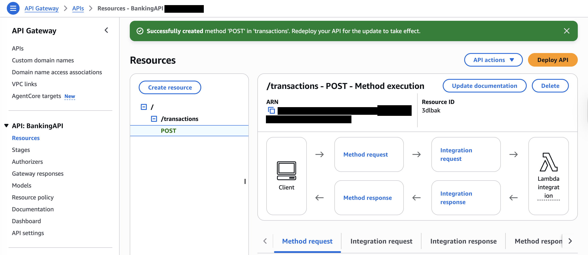
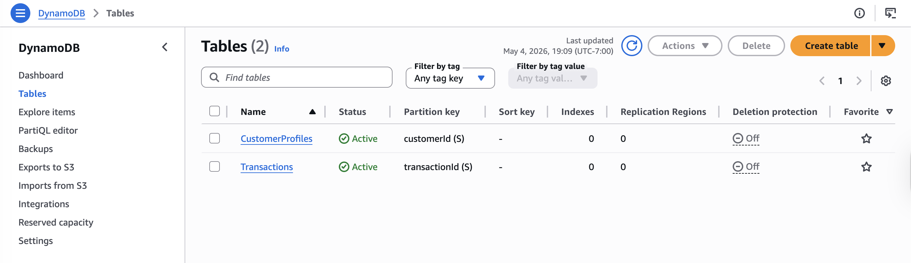

# Secure Banking Data Platform on AWS

I designed a secure, scalable architecture for a retail bank moving customer and transaction data to AWS, then deployed and tested its core in my own AWS account. The deployment includes a serverless transaction API (API Gateway → Lambda → DynamoDB) with fraud-check logic, a relational database tier, a user identity pool, and account-wide audit logging with tamper-evident log validation.


**Services:** API Gateway · Lambda · DynamoDB · RDS (MySQL) · Cognito · IAM · CloudTrail · CloudWatch · S3


## Highlights

- **Serverless transaction API.** A REST API (`BankingAPI`) with `GET` and `POST /transactions` integrated with a Lambda function, deployed to a `prod` stage with throttling.
- **Fraud-screening logic.** `BankingProcessor` returns each transaction with `fraudFlag` and `reviewRequired` decisions and a timestamp.
- **Data tier.** DynamoDB tables for customer profiles and transactions, plus an RDS MySQL instance for relational banking data.
- **Identity.** A Cognito user pool for customer and staff authentication, and a dedicated IAM execution role for the Lambda function.
- **Audit and compliance logging.** A multi-region CloudTrail trail delivering to S3 and CloudWatch Logs, with log file integrity validation (digest files).
- **Tested end to end.** Live HTTPS calls to the `prod` endpoint returned `200 OK` in about 220–310 ms.

## Architecture

| Layer | Design | Deployed |
|---|---|---|
| API edge | API Gateway with throttling and WAF | ✅ API Gateway REST API, `prod` stage (10,000 rps / 5,000 burst) |
| Identity | Cognito user pools with MFA | ✅ Cognito user pool · ⏭ authorizer and MFA |
| Compute | Lambda + Step Functions | ✅ Lambda `BankingProcessor` |
| Data | DynamoDB, RDS, S3 | ✅ DynamoDB ×2, ✅ RDS MySQL `banking-db` |
| Encryption | KMS keys for all data stores | ⏭ Planned |
| Audit | CloudTrail + CloudWatch | ✅ Multi-region trail → S3 + CloudWatch Logs |

✅ deployed · ⏭ next phase

```
Client ──HTTPS──► API Gateway (BankingAPI, prod) ──► Lambda (BankingProcessor) ──► DynamoDB
                                                         │ IAM: LambdaBankingRole      ├ Transactions
                                                                                       └ CustomerProfiles
RDS MySQL (banking-db) · Cognito user pool
CloudTrail (all regions) ──► S3 log bucket (+ integrity digests) ──► CloudWatch Logs
```

Design details: [docs/architecture.md](docs/architecture.md).

## Implementation

**API Gateway → Lambda.** The `/transactions` resource exposes `POST` and `GET`, both with Lambda integration, deployed to `prod`.



**Fraud-check function.** A Lambda test run returns the transaction with its fraud and review decision in about 29 ms.


**Data stores.** DynamoDB tables keyed on `customerId` and `transactionId`, plus the RDS MySQL instance.



**Audit trail.** `banking-audit-trail` logs every region to S3 and CloudWatch Logs. Integrity digest files confirm that log file validation is on.


Configuration for each service is in [docs/implementation.md](docs/implementation.md).

## Results

| Test | Result |
|---|---|
| `POST /prod/transactions` over HTTPS | ✅ 200 OK (223 ms, 307 ms) |
| Lambda execution with test event | ✅ Succeeded, 24–29 ms, 93 MB of 128 MB |
| Fraud-check output | ✅ `fraudFlag` and `reviewRequired` returned |
| DynamoDB and RDS provisioned | ✅ Active / Available |
| CloudTrail logging | ✅ Logging, multi-region, CloudWatch delivery |
| Log integrity validation | ✅ Digest files written to S3 |


Full results: [docs/validation.md](docs/validation.md).

> The environment ran as designed at project completion. It has since been shut down to control costs, and the screenshots in this repository record the deployed state.

## Key Takeaways

- **Build the path first, then layer the controls.** Getting API → Lambda → DynamoDB working end to end gave a stable base for adding identity, encryption, and edge protection.
- **Authentication belongs at the API edge.** A Cognito authorizer on API Gateway enforces it before any compute runs.
- **Pick one integration model.** Using a Lambda proxy integration, or mapping the response in API Gateway, keeps clients from double-parsing the payload.
- **Logs become monitoring with alarms.** CloudTrail with validation provides an auditable record, and CloudWatch alarms on IAM, KMS, and API changes would turn it into detection.

## Next Steps

- Attach a Cognito authorizer to the API and enable MFA.
- Encrypt DynamoDB, RDS, and S3 with customer-managed KMS keys.
- Add AWS WAF to the `prod` stage.
- Enable RDS Multi-AZ and automated backups; add Step Functions for KYC workflows.
- Codify the stack in infrastructure-as-code (CloudFormation, CDK, or Terraform).

## Repository Guide

| Path | Contents |
|---|---|
| [`docs/architecture.md`](docs/architecture.md) | Target design and deployed components |
| [`docs/implementation.md`](docs/implementation.md) | Configuration of each service and test outputs |
| [`docs/validation.md`](docs/validation.md) | Functional, security, and availability results |
| [`docs/evidence-index.md`](docs/evidence-index.md) | Every claim mapped to its screenshot (account identifiers redacted) |

---

© 2026 Ghazal Mahdian. The bank is a fictional scenario. All test data is synthetic.
