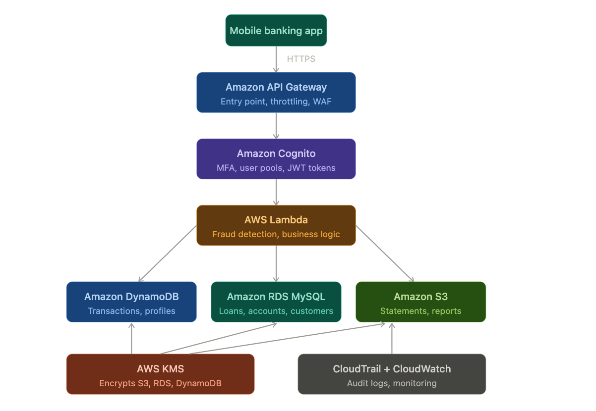
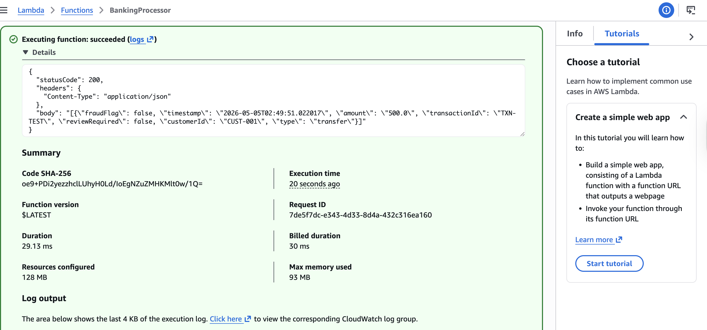
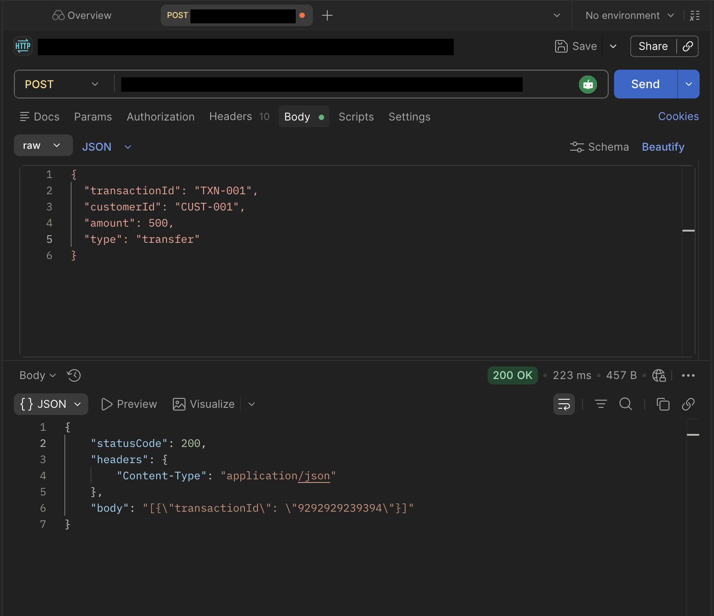
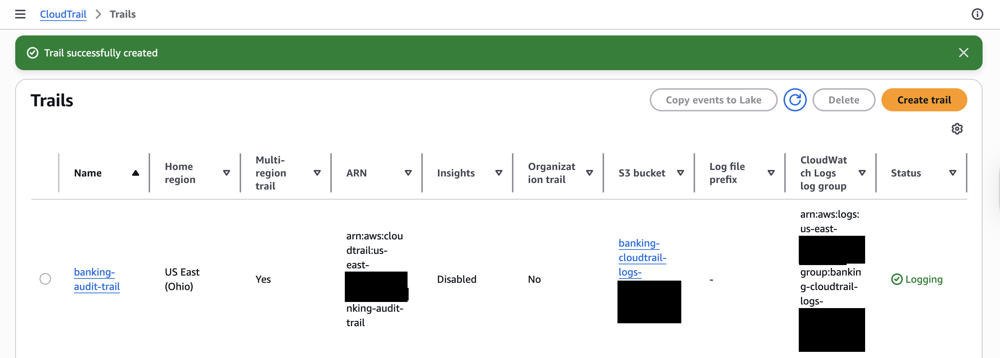

# AWS Banking Data Platform: Security Case Study

A graduate DevOps final (CYB535) built around a fictional retail bank moving customer and transaction data to AWS. The assignment proposed a serverless architecture with API Gateway, Lambda, DynamoDB, Aurora, S3, KMS, Cognito, Step Functions, CloudTrail, and CloudWatch, along with security and compliance goals. This repository records the part of that design that was deployed and tested in a personal AWS account, and keeps it separate from the parts that remain proposed.

The deployed part is a working request path. A REST API in API Gateway invokes a Lambda function that returns transaction records with a fraud-check flag, backed by two DynamoDB tables. A multi-region CloudTrail trail logs to S3 and CloudWatch Logs. An RDS MySQL instance, a Cognito user pool, and an IAM role were also created.

> **Scope note.** The bank is an instructor-provided scenario. No real customer data was used; test records are `CUST-001` / `TXN-001` / `TXN-TEST`. Nothing here demonstrates PCI DSS, GLBA, or SOX compliance, zero downtime, or production readiness. Those are assignment goals, not results.

## At a glance

| | |
|---|---|
| Context | CYB535 final; console work on 4 May 2026 (us-east-2), diagram 9 May 2026 |
| Strongest evidence | API call `POST /prod/transactions` returning 200; Lambda test with fraud-flag output; CloudTrail trail "Logging" with digest files in S3 |
| Created, not integrated | Cognito user pool (0 users, no authorizer shown); RDS MySQL `banking-db` |
| Proposed only | KMS customer keys, Step Functions, WAF, MFA, Aurora, Multi-AZ, S3 document storage with versioning |
| Current state | Resources have been shut down for budget reasons; they were running normally at project completion (author's statement) |
| Missing | Lambda code, IAM policies, any infrastructure-as-code, written report |

## Business problem and lab context

The scenario bank has fragmented customer data, limited real-time insight, and ageing on-premises systems. The assignment set four requirements: encryption at rest and in transit, real-time access for staff and apps, scaling for peak load, and alignment with PCI DSS, GLBA, and SOX. It supplied a reference architecture and data flow (mobile app → API Gateway → Cognito MFA → Lambda → DynamoDB/RDS/S3).

## My contribution

The AWS console screenshots come from an account labelled with the author's name. They show the author creating:

- REST API `BankingAPI` with a `/transactions` resource, `GET` and `POST` methods using Lambda integration, and a `prod` stage
- Lambda function `BankingProcessor` with test event `BankingProcessorTest`, and IAM role `LambdaBankingRole`
- DynamoDB tables `CustomerProfiles` (key `customerId`) and `Transactions` (key `transactionId`)
- RDS instance `banking-db` (MySQL Community)
- Cognito user pool
- CloudTrail trail `banking-audit-trail` with an S3 bucket and CloudWatch Logs log group

The API was tested from an HTTP client (Postman), and an architecture diagram was produced. This was individual work; no written report was produced. Authorship of the diagram is not recorded.

## Tools and technologies evidenced

| Service | Evidenced state |
|---|---|
| Amazon API Gateway (REST) | `BankingAPI`, `/transactions` GET + POST → Lambda, stage `prod` (rate 10,000, burst 5,000, no cache, **no Web ACL**) |
| AWS Lambda | `BankingProcessor`, 128 MB, test runs ~24–29 ms, max 93 MB used; runtime and code not shown |
| AWS IAM | Role `LambdaBankingRole` created; attached policies not shown |
| Amazon DynamoDB | Two tables, partition key only, no indexes, deletion protection off |
| Amazon RDS | `banking-db`, MySQL Community, single instance, us-east-2b, Available |
| Amazon Cognito | User pool, Essentials plan, 0 users; MFA and app clients not shown |
| AWS CloudTrail | `banking-audit-trail`, multi-region, Logging, S3 + CloudWatch Logs delivery |
| Amazon S3 | CloudTrail log bucket with digest files under `CloudTrail-Digest/us-east-2/2026/05/05/` |
| CloudWatch | Lambda log group link; CloudTrail log group; no alarms or dashboards shown |
| Postman | Two `POST` requests to the `prod` endpoint, both 200 OK |

Not evidenced: AWS KMS customer-managed keys, Step Functions, AWS WAF, Aurora, Multi-AZ, Cognito MFA, an API authorizer, S3 document storage or versioning, VPC design, or infrastructure-as-code.

## Architecture overview

*Target architecture diagram (9 May 2026): mobile app → API Gateway (throttling, WAF) → Cognito (MFA, JWT) → Lambda (fraud detection) → DynamoDB, RDS MySQL, S3, with KMS encryption and CloudTrail/CloudWatch auditing. This shows the **design**; several components were not deployed (see below). Its authorship and tooling are not documented.*

| Layer | Proposed | Deployed and evidenced |
|---|---|---|
| Edge | API Gateway + WAF | API Gateway REST API; **no Web ACL** on `prod` |
| Identity | Cognito user pools with MFA | User pool exists (0 users); not attached to the API in any capture |
| Compute | Lambda + Step Functions | Lambda `BankingProcessor`; no Step Functions |
| Data | DynamoDB, Aurora/RDS, S3 | DynamoDB ×2 used by the API; RDS MySQL created; S3 used only for CloudTrail logs |
| Keys | KMS for all stores | Not shown |
| Audit | CloudTrail + CloudWatch | CloudTrail multi-region → S3 + CloudWatch Logs; digest files present |

More detail is in [docs/architecture.md](docs/architecture.md).

## Implementation highlights

- **Serverless request path.** `/transactions` exposes `GET` and `POST`, each wired to `BankingProcessor`, and was deployed to `prod`.
- **Fraud-check output.** A Lambda test returns a record with `fraudFlag: false`, `reviewRequired: false`, a timestamp, amount, customer, and type. This shows that the function applies some review logic, but the rules themselves are not visible.
- **Audit trail with integrity files.** The trail is multi-region and delivers to both S3 and CloudWatch Logs. CloudTrail writes digest files only when log file integrity validation is enabled, so the digest objects in S3 indicate validation was on.

*Lambda console test: execution succeeded (29.13 ms, 93 MB of 128 MB). The response body lists a transaction `TXN-TEST` for `CUST-001`, amount 500.0, type transfer, `fraudFlag: false`, `reviewRequired: false`.*

*Postman `POST` to the `prod` `/transactions` endpoint (URL redacted) with body `TXN-001 / CUST-001 / 500 / transfer`: 200 OK in 223 ms. The response body lists a different transaction ID, and Lambda's `statusCode`/`headers`/`body` object is wrapped inside the HTTP body.*

*CloudTrail: `banking-audit-trail`, home region US East (Ohio), multi-region yes, Insights disabled, status Logging, with S3 bucket and CloudWatch Logs log group configured (account-specific names redacted).*

## Validation summary

| Area | Status |
|---|---|
| API Gateway → Lambda over HTTPS | Demonstrated (200 OK) |
| POST persists the submitted transaction | Not demonstrated; responses do not echo `TXN-001` |
| Lambda fraud-check logic | Demonstrated (output only) |
| Audit logging | Demonstrated (trail Logging, digest files) |
| Authentication on the API (Cognito/MFA) | Not shown |
| KMS encryption at rest | Not shown |
| WAF | Not configured (`Web ACL: –`) |
| High availability / DR | Not shown (single-AZ RDS instance) |
| Compliance (PCI DSS, GLBA, SOX) | Not assessed |

Full table: [docs/validation.md](docs/validation.md).

## Limitations and missing artifacts

- No Lambda code, IAM policy documents, API Gateway method settings, or infrastructure-as-code are available. The deployment cannot be reproduced from this repository.
- The API's authorization setting is not visible, and no `Authorization` header appears in the test requests.
- The Postman responses do not reflect the posted record. The first returns a different `transactionId`; the second returns an empty list. Whether `POST` writes to DynamoDB is not shown.
- The Lambda runtime and version are not shown.
- Encryption settings (DynamoDB, RDS, S3), RDS Multi-AZ and backups, and Cognito MFA are not visible in any capture.
- The AWS resources have since been shut down for budget reasons, so the deployment can no longer be inspected live. The author reports that everything ran normally at completion. The screenshots are the only record.
- Account ID, API ID, user pool ID, and account-derived bucket and log group names are redacted in the screenshots.

## Lessons learned

No written reflection was supplied for this project.

**Suggested reflections — for your review before publishing:**
- A reference architecture lists many controls. Deploying the request path first, then adding identity (a Cognito authorizer) and keys (KMS), shows the order security controls are usually layered in.
- A public `prod` stage with no authorizer and no WAF is reachable by anyone who has the URL. In a real system, authentication would be the first control added after the API works.
- The HTTP response contains Lambda's own `statusCode`/`headers`/`body` object. That pattern usually means the method uses a non-proxy integration while the function returns a proxy-style response. Choosing one model keeps clients from double-parsing.
- CloudTrail with log file validation and CloudWatch Logs delivery gives an auditable record. Connecting it to alarms (for example, on IAM or KMS changes) would turn logging into monitoring.

## Reviewing this repository

1. [docs/architecture.md](docs/architecture.md) separates proposed from deployed components.
2. [docs/validation.md](docs/validation.md) gives the test-by-test status.
3. [docs/implementation.md](docs/implementation.md) records the configuration and outputs visible in each screenshot.
4. [docs/evidence-index.md](docs/evidence-index.md) maps claims to screenshots and lists redactions.

There is nothing to deploy from this repository.

## Use and licensing

No license is applied. The case study text belongs to the course instructor; screenshots are shared for portfolio review only.
